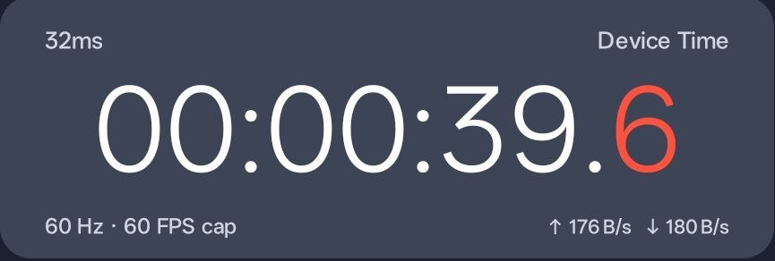
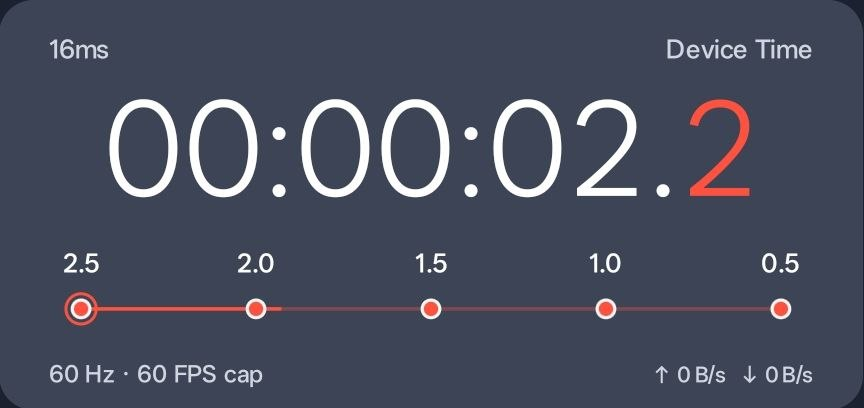

# Precision Floating Clock

A small, offline native Kotlin Android utility for EL. Set a device-local target and float the countdown above other apps. Android 8.0+; targets Android 15 (API 35).

## Preview





<video controls width="480" src="docs/media/precision-clock.mp4"></video>

[Download or watch the demo video](docs/media/precision-clock.mp4)

## Install on your phone

1. Download **PrecisionClock-1.0.0-debug.apk** and open it in Files/Downloads.
2. If Android asks, allow installation from the browser or Files app you used. Install Precision Clock.
3. Open Precision Clock → **Choose target time & date**, or tap a quick target.
4. Tap **Enable floating clock**. Allow **Display over other apps**, then return to Precision Clock. Allow notifications for convenient controls.
5. The countdown starts immediately. Open **Style** to change width, opacity, text size, rounding and colors. Open **Float** to lock, enable touch-through, hide or reset position.

Drag the card to move it, pinch to resize, long-press for settings, or double-tap to hide. Notification actions show/hide or stop it. The main application always offers recovery from touch-through. If notifications were denied, reopen the app directly.

The **10-second test countdown** is the fastest way to check the five dots. They must be absent above 3 seconds, appear at 3 seconds, react at 2.5/2.0/1.5/1.0/0.5, then disappear at zero.

This is a personal debug build. No Play Store submission or device installation has been performed by the developer. Debug signing keys generated on separate machines/runners differ, so an APK from a future independent Actions run may require uninstalling the earlier build first; this erases local preferences. Preserve the same signing key privately for stable future updates, never commit it.

## Features

- Native Canvas card: #3D4456 background, white tabular-cell digits, #FF513D fractional digits and timeline.
- `HH:MM:SS.d`, with optional 2 or 3 fractional digits. Positive fractions round upward, so an unfinished interval is not rounded to zero.
- Next occurrence, one-time absolute date/time, daily local-time repeat, target milliseconds; 12/24-hour picker and local display.
- Quick midnight, next minute, next hour and 10-second test targets.
- Timeline fully absent outside `0 < remaining <= 3000 ms`; no blank timeline area. Five vector checkpoints share the numeric countdown value.
- Silent default completion, optional subtle flash or short vibration; optional hide after one-time completion. Daily schedules hold zero for 1.2 seconds and advance by local calendar day.
- Resizable, draggable overlay; safe display bounds, saved relative position, adjustable opacity, compact mode, locked position and touch-through.
- Actual display refresh rate and independent rendering caps: 30, 60, Auto, 90, 120. Display vsync naturally limits rendering to the device's active refresh rate. No attempt to force panel refresh.
- Optional measured drawing interval and approximately one-second total traffic counter sampling. No fabricated stats.
- All preferences stay on the device. No ads, subscriptions, backend, analytics, accounts, internet permission or accessibility service.

## Timing and platform limitations

The authoritative source is `System.currentTimeMillis()`, the phone's wall clock. A monotonic anchor is checked against the wall clock every frame and reanchored on discrepancies and at least every 250 ms. Remaining time is calculated from target minus current time, rather than subtracting render intervals. Completion holds use monotonic elapsed time. A stopped one-time target remains latched at zero until changed.

An absolute date/time target remains the same instant when the timezone changes. A daily target follows the local timezone. DST gaps shift forward by the gap; overlapping local times use the first occurrence, once per date. A saved next-occurrence target becomes a fixed instant once configured. Changing the clock can jump the visible countdown as expected.

The optional `ms` reading measures intervals between actual Canvas draw callbacks, smoothed over recent draws. It is not NTP accuracy, internet ping, CPU drawing cost, GPU presentation time, or a guarantee that a frame reached the display. The original screenshot's metric cannot be identified from its label alone; draw interval is a deliberately defined alternative. At 60 draws/second it is around 16.7 ms; lower caps/power saver increase it.

Rendering is synchronized to `Choreographer`. The exact visible transition depends on frame availability, scheduler delays and screen refresh. Higher FPS does not guarantee millisecond timing or an accurate device clock. No network time synchronization is performed.

Power saver limits drawing to 30 FPS outside the final 10 seconds. Drawing stops when the screen goes off. There is no wake lock, exact alarm or background boot launch; completion effects while asleep or suspended may be delayed until the next active render. Android/vendor battery policies may terminate even foreground services; reopen the app and enable the clock if necessary. This utility is not an alarm-clock replacement.

Android 12+ blocks touches through overly opaque untrusted overlays. Touch-through uses `FLAG_NOT_TOUCHABLE` and clamps effective window opacity to the system's maximum (typically 80%) while keeping the saved requested opacity. The notification/main app remain available. Secure apps, permission screens and system surfaces can refuse or hide overlays; this app respects that restriction.

Network rates are deltas of `TrafficStats.getTotalRxBytes/getTotalTxBytes`, divided by monotonic elapsed time, across interfaces Android exposes. They are approximate and may include VPN/virtual-interface effects; they are not a billing meter or per-app attribution. Unsupported/reset/restricted counters show a dash and establish a fresh baseline. Zero traffic is displayed only when valid counters actually show no increase. No usage-access or phone-state permission is required.

Foreground overlay service type is `specialUse`, with a declared subtype explaining its purpose. Starting is user initiated from the visible Activity, as required by modern Android background-start restrictions. Notification visibility depends on notification permission/settings; the foreground service still has its system entry when drawer permission is denied.

## Build locally

Requires JDK 17+, Android SDK platform 35 and build-tools 35.0.0. Set `ANDROID_HOME` to your SDK or provide an untracked `local.properties` containing `sdk.dir=/absolute/sdk/path`.

```bash
bash ./gradlew --no-daemon testDebugUnitTest lintDebug assembleDebug
```

APK: `app/build/outputs/apk/debug/app-debug.apk`.

Runtime dependencies: Kotlin standard library plus Android platform APIs. Test-only dependencies: JUnit 4.13.2 and Robolectric 4.14.1. Gradle wrapper pins 8.11.1 with its SHA-256 checksum. AGP 8.9.2 and Kotlin 2.1.20 are pinned for this API35 build.

## Phone-only GitHub Actions route

The supplied workflow runs on push or manual dispatch, installs JDK17/SDK35, runs tests and lint, builds the debug APK, checks it exists, and uploads it as **PrecisionClock-debug-APK**. A second artifact contains reports and real Android Canvas snapshots. Actions are pinned to resolved commit SHAs. Repository Actions minutes/retention are subject to your GitHub account's limits; no paid service is required by the app.

For a phone-only self-upload, use Termux from its official distribution:

1. Download the source ZIP and extract it with your phone's file manager.
2. In Termux: `pkg install git gh unzip`, then `termux-setup-storage` and allow access to the downloaded project.
3. `gh auth login --web --git-protocol https --scopes workflow`. The workflow scope lets GitHub accept the Actions YAML file.
4. `cd` to the extracted `precision-floating-clock-android` folder and run `bash phone-upload.sh`.
5. Set `GITHUB_REPOSITORY=OWNER/REPOSITORY` and run `bash phone-upload.sh`. The script refuses to touch an existing repository or existing git checkout. It creates a private repository, commits this project and pushes it. Open its Actions tab and wait for the build.
6. Open the successful run → **Artifacts → PrecisionClock-debug-APK**, download/extract the ZIP and install its APK.

No credentials belong in source files. The upload script uses the GitHub CLI session already configured on the device.

## Project structure

| File | Responsibility |
| --- | --- |
| `Timing.kt` | Calendar recurrence, countdown state, threshold model, clock reconciliation, formatting and traffic deltas |
| `ClockStore.kt` | Local configuration, persistence and daily timezone reconciliation |
| `ClockView.kt` | Vector card drawing, adaptive height, digit cells, timeline and draw scheduling |
| `LiveMetrics.kt` | Real display refresh rate and TrafficStats sampling |
| `OverlayService.kt` | Foreground notification, overlay lifecycle, gestures, safe placement and touch-through |
| `MainActivity.kt` | Dashboard, preview, target editor, appearance, floating and performance settings |
| `.github/workflows/android.yml` | Reproducible cloud test/lint/APK build and artifacts |

## Verification

See `docs/VALIDATION.md` for the actual build/test results and physical-device checklist. Robolectric tests exercise Android APIs in a JVM environment, not a physical phone or full Android emulator. The screenshot reference was not attached in the implementation turn, so exact pixel comparison was unavailable; the card follows the supplied colors, hierarchy, labels and proportions.

## License

This project is released under the MIT License. See [LICENSE](LICENSE).

## Android references

- [Foreground service types, including specialUse](https://developer.android.com/develop/background-work/services/fgs/service-types)
- [Android 15 background-start changes](https://developer.android.com/about/versions/15/behavior-changes-15)
- [Overlay touch security and LayoutParams](https://developer.android.com/reference/android/view/WindowManager.LayoutParams)
- [TrafficStats](https://developer.android.com/reference/android/net/TrafficStats)
- [AGP 8.9 compatibility](https://developer.android.com/build/releases/agp-8-9-0-release-notes)
