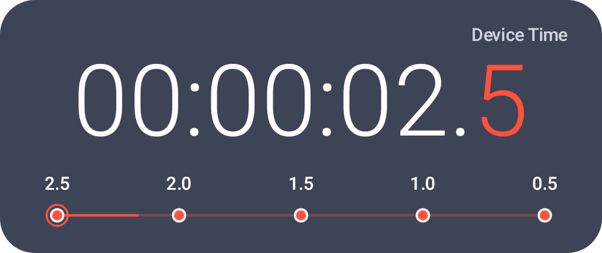

# Precision Clock

A floating Android countdown that keeps your next moment in view.

Set an exact time on your device's local clock, then keep a clean, resizable countdown above other apps. Built with native Kotlin and Android Canvas. Works offline, with no account, ads, or subscriptions.

[](https://github.com/ELith03/precision-floating-clock-android/actions/workflows/android.yml)
[](LICENSE)

## Download

### [Download the Android APK — v1.0.1](https://github.com/ELith03/precision-floating-clock-android/releases/download/v1.0.1/PrecisionClock-1.0.1-debug.apk)

**Android 8.0 or newer · Early-access debug build · No GitHub sign-in required**

[Release notes and checksums](https://github.com/ELith03/precision-floating-clock-android/releases/tag/v1.0.1) · [All releases](https://github.com/ELith03/precision-floating-clock-android/releases)

Download the `.apk` directly and open it on your phone. You do not need Android Studio, a computer, or a GitHub Actions artifact ZIP.

> This is a debug build for testing. If Android reports a signing conflict with a previously installed build, uninstall the older build first. Uninstalling clears saved settings. Independently built debug APKs can have different signing keys.

<p align="center">
  
</p>

## Get started

1. **Install:** open the downloaded APK. If Android asks, allow installation from the browser or Files app you used.
2. **Set a target:** open **Precision Clock** and choose a time/date, a daily repeat, or a quick preset.
3. **Enable floating mode:** tap **Enable floating clock**, allow **Display over other apps**, and return to the app.
4. **Allow notifications:** use the notification to reopen settings, show/hide the clock, or stop it.
5. **Make it yours:** use **Style** for size, opacity, colors, and digit precision; use **Float** for position lock and touch-through.

For a quick check, choose **10-second test countdown** and watch the checkpoints appear during the final three seconds.

## What it does

| Feature | Details |
| --- | --- |
| Local-time targets | Next occurrence, a one-time date/time, or a daily repeating time; optional target milliseconds |
| Precision display | `HH:MM:SS.d`, with optional two or three fractional digits and stable digit spacing |
| Final-three-second timeline | Five checkpoints at **2.5 · 2.0 · 1.5 · 1.0 · 0.5** seconds; completely hidden before the final three seconds and at zero |
| Floating controls | Drag to move, pinch to resize, lock position, hide/show, and optional touch-through |
| Appearance | Adjustable width, opacity, digit size, corner radius, accent/background colors, and compact/full layouts |
| Display information | Actual display refresh rate, independent render caps, and an optional measured drawing interval |
| Network information | Optional upload/download rates from Android's traffic counters, sampled about once a second |
| Completion | Silent by default; optional flash, vibration, or hide-after-completion; daily targets advance after a brief zero hold |

### A countdown to a real target

For a target of midnight, if the device time is `23:59:57.500`, the clock shows `00:00:02.5`. It reaches zero at the selected timestamp instead of running as a stopwatch.

Time-only targets select the **next future occurrence**. Daily targets follow the device's current timezone and advance by calendar date. A one-time date/time remains the same absolute instant if the timezone changes.

### The last three seconds

The line spans **3.0 → 0.0 seconds**. The five dots sit inside that range, at 2.5, 2.0, 1.5, 1.0, and 0.5. The moving line reaches each dot when it activates.

| Remaining time | Behavior |
| --- | --- |
| More than 3 seconds | Countdown only; no checkpoint line, dots, labels, or reserved timeline space |
| 3.000 seconds | Timeline appears at the left endpoint |
| 2.5 / 2.0 / 1.5 / 1.0 / 0.5 seconds | Checkpoints activate in order |
| 0 seconds | Progress reaches the right endpoint; countdown stops at zero and the timeline disappears |

## Controls

| Action | Control |
| --- | --- |
| Move the overlay | Drag while unlocked |
| Resize | Pinch with two fingers, or change **Style → Width** |
| Adjust transparency | **Style → Opacity** |
| Open settings from the overlay | Long-press |
| Hide the overlay | Double-tap, the app, or the notification |
| Restore or stop it | The notification or main app |
| Prevent movement | **Float → Lock position & size** |
| Let touches reach the app underneath | **Float → Touch-through** |

When touch-through is on, use the notification or main app to change settings. Android 12+ can limit the effective opacity of touch-through overlays, typically to 80%.

## Screenshots

<p align="center">
  
  
</p>

## Privacy and permissions

The app stores preferences locally. It has **no internet permission**, analytics, backend, login, or advertising SDK.

| Permission | Purpose |
| --- | --- |
| Display over other apps | Show the floating clock |
| Foreground service / special use | Keep the user-started overlay service running with system controls |
| Notifications | Provide settings, hide/show, and stop controls |
| Vibration | Optional short completion vibration |

Network-rate counters are read locally through Android APIs; displaying them does not require sending data anywhere. No root or accessibility service is used.

## Timing, performance, and limitations

- **Device time is the source.** Remaining time is calculated from the target timestamp and current clock, with a monotonic anchor reconciled against wall time. UI intervals are not repeatedly subtracted, so skipped frames do not accumulate countdown drift.
- **Visible precision has limits.** Display frames, OS scheduling, and the accuracy of the device clock affect what you see. Fractional values round upward so a positive remaining interval is not formatted as zero. This app does not perform network time synchronization.
- **Hz and FPS mean different things.** Hz reports the active display mode. A 30/60/90/120 FPS cap limits drawing workload; it does not force the hardware refresh rate. Auto follows available display frames. Power saver caps drawing at 30 FPS outside the final ten seconds.
- **The `ms` label is a measured draw interval.** It averages time between Canvas draw callbacks. It is not clock-sync accuracy, internet latency, CPU rendering cost, or proof of presentation to the display.
- **Network rates are approximate.** TrafficStats totals can be affected by VPNs, virtual interfaces, and vendor restrictions. A dash means unavailable statistics or a fresh baseline.
- **Android controls overlays.** Secure apps and system screens can hide them. Battery policies can stop the service; reopen the app to restart it if needed.
- **Screen-off rendering pauses.** There is no CPU wake lock, exact alarm, or boot-time auto-start. Completion effects can be delayed until the device wakes. Use a dedicated alarm app for wake-up alerts.
- **Daily schedules follow local calendar rules.** Daylight-saving gaps shift forward, and repeated local times use the first occurrence once per date. Daily completion holds zero for about 1.2 seconds before advancing.

## Build from source

Requirements: **JDK 17+**, Android SDK **platform 35**, and **build-tools 35.0.0**. Set `ANDROID_HOME` or create an untracked `local.properties` with `sdk.dir=/path/to/android-sdk`.

```bash
git clone https://github.com/ELith03/precision-floating-clock-android.git
cd precision-floating-clock-android
bash ./gradlew --no-daemon testDebugUnitTest lintDebug assembleDebug
```

On Windows, use `gradlew.bat` instead of `bash ./gradlew`.

The APK is written to `app/build/outputs/apk/debug/app-debug.apk`. Runtime dependencies are limited to Kotlin's standard library and Android platform APIs. Gradle, AGP, Kotlin, and test dependencies are version-pinned.

The [GitHub Actions workflow](.github/workflows/android.yml) runs tests, lint, and compilation on pushes and manual dispatches. Successful builds upload APK/checksum and validation artifacts. Tagged APKs are attached after a successful main-branch build. Existing downloads stay unchanged.

## Development and validation

The automated suite covers timing, recurrence, clock changes, checkpoint thresholds, formatting, preference persistence, overlay policies/lifecycle, landscape sizing, and native Canvas previews. See [validation and the device checklist](docs/VALIDATION.md) for test coverage and the limits of JVM-based Android testing.

Physical-device testing remains important, particularly for overlays, touch-through, cutouts, refresh rates, and vendor battery behavior.

| Source | Responsibility |
| --- | --- |
| [`Timing.kt`](app/src/main/java/com/elith/precision/Timing.kt) | Scheduling, countdown state, clock reconciliation, formatting, and traffic deltas |
| [`ClockStore.kt`](app/src/main/java/com/elith/precision/ClockStore.kt) | Local settings and daily timezone reconciliation |
| [`ClockView.kt`](app/src/main/java/com/elith/precision/ClockView.kt) | Vector drawing, adaptive layout, timeline, and frame scheduling |
| [`LiveMetrics.kt`](app/src/main/java/com/elith/precision/LiveMetrics.kt) | Display refresh rate and network sampling |
| [`OverlayService.kt`](app/src/main/java/com/elith/precision/OverlayService.kt) | Foreground service, notification, gestures, positioning, and touch-through |
| [`MainActivity.kt`](app/src/main/java/com/elith/precision/MainActivity.kt) | Dashboard and settings |

Bug reports and pull requests are welcome. Include your Android version, phone model, steps to reproduce, and relevant screenshots. Please follow [CONTRIBUTING.md](CONTRIBUTING.md).

## License

[MIT](LICENSE) · Copyright © 2026 EL
